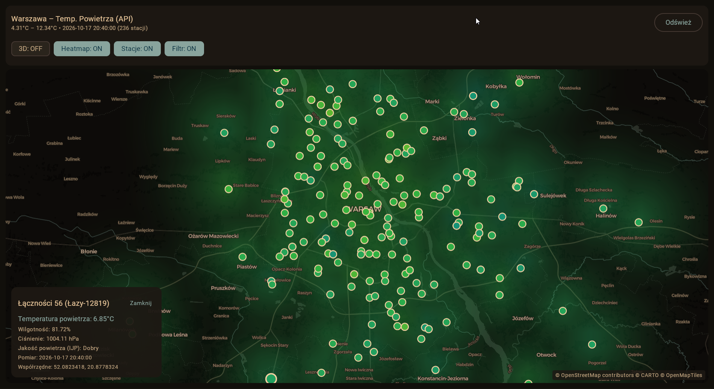
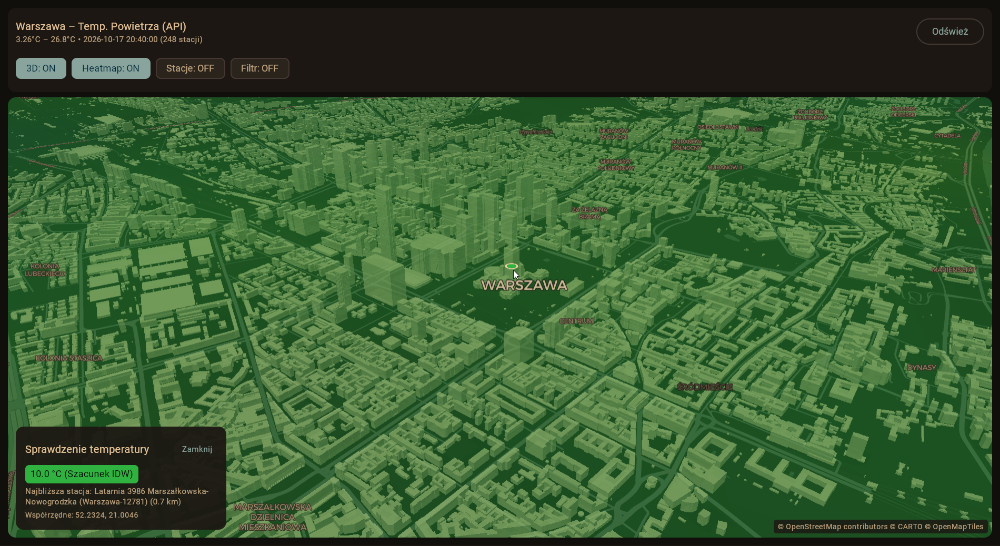

# OpenData Warsaw

Repository for working with **Warsaw Open Data** (`dane.um.warszawa.pl`).

---

## Submodules Linktree

- [**`api-gen/`**](./api-gen/README.md) – Python utility for fetching metadata from `dane.um.warszawa.pl` and compiling OpenAPI 3.0 specifications (`openapi.yaml` / `openapi.json`).
- [**`app/`**](./app/README.md) – Kotlin Multiplatform & Compose Multiplatform app targeting Android and Web (Kotlin/Wasm). Map of Warsaw showing the heat distribution.
- [**`docs/`**](./docs/ApiList.md) – API reference documentation, list of endpoints, and pre-compiled OpenAPI specifications.

---

## Quick Start

This repository uses [`just`](https://github.com/casey/just) as a central task runner for cross-module development tasks. Run it to access further documentation.